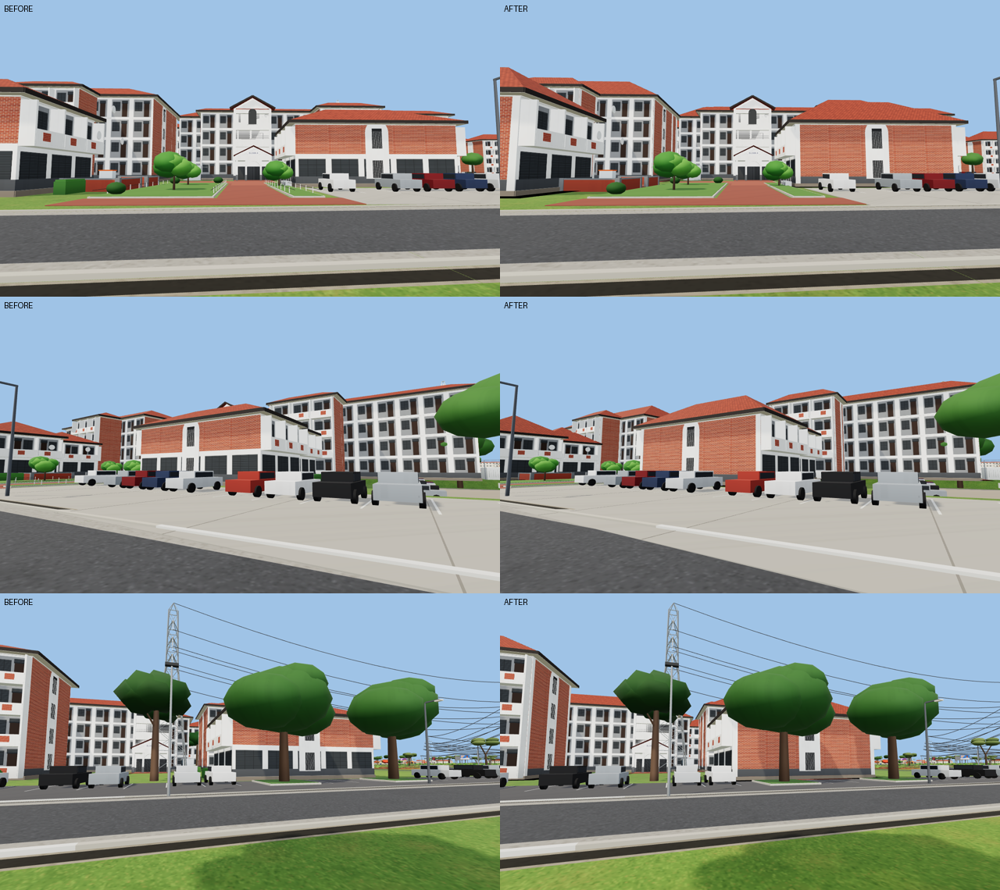
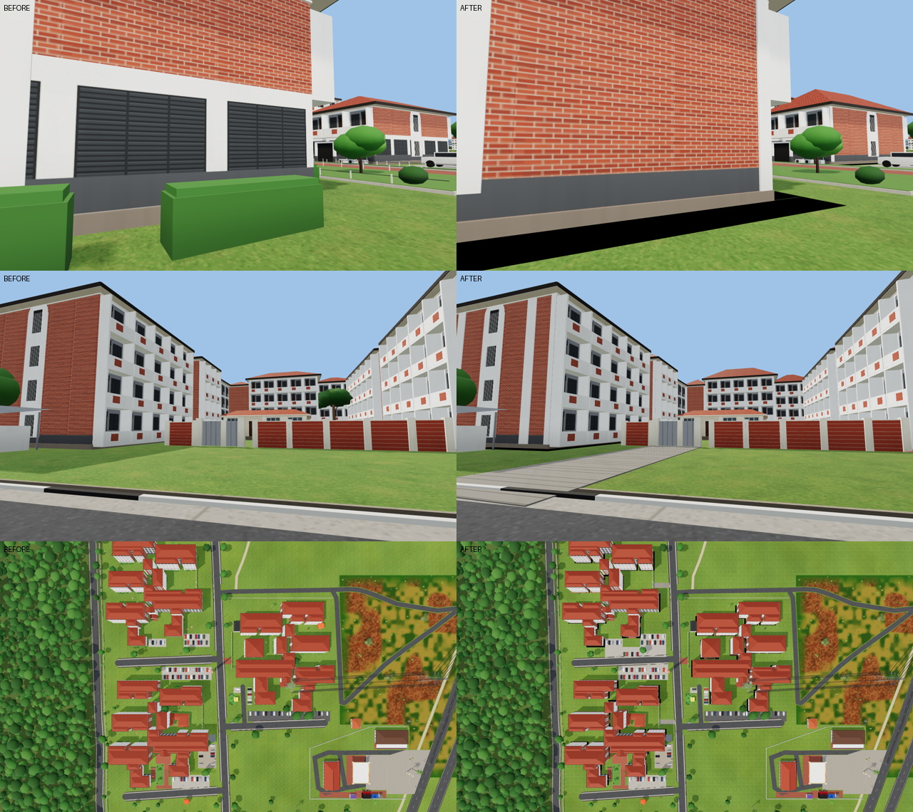
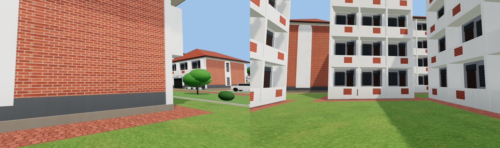
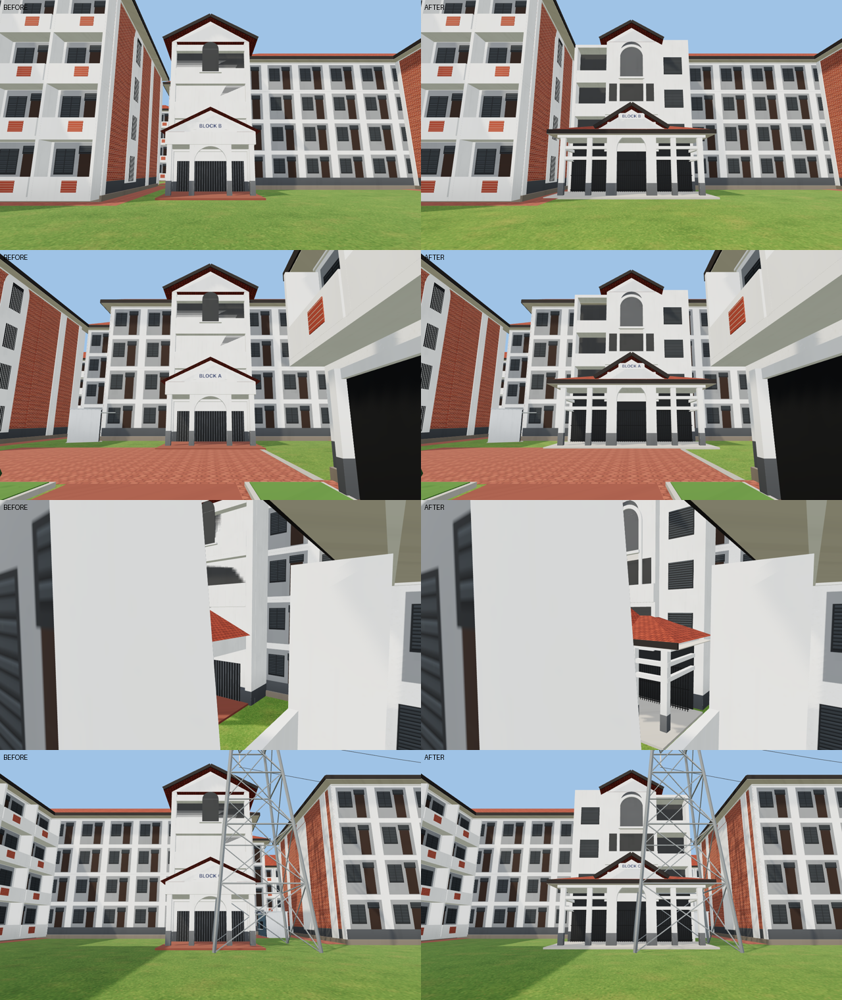
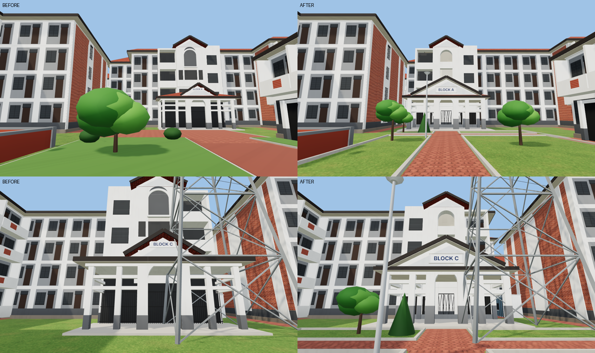
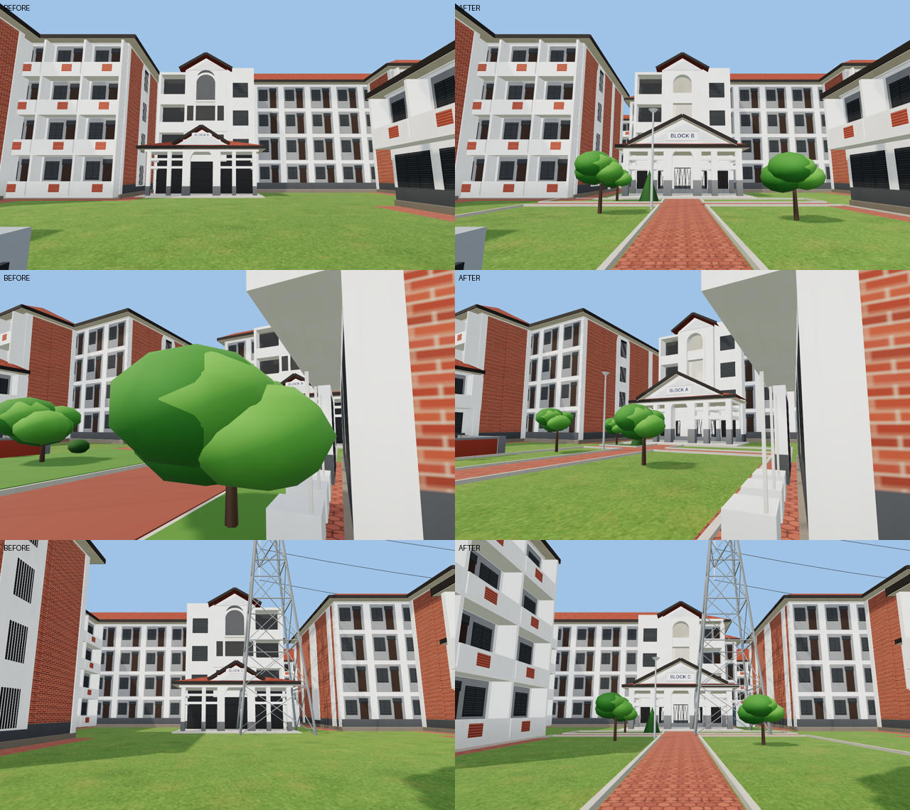
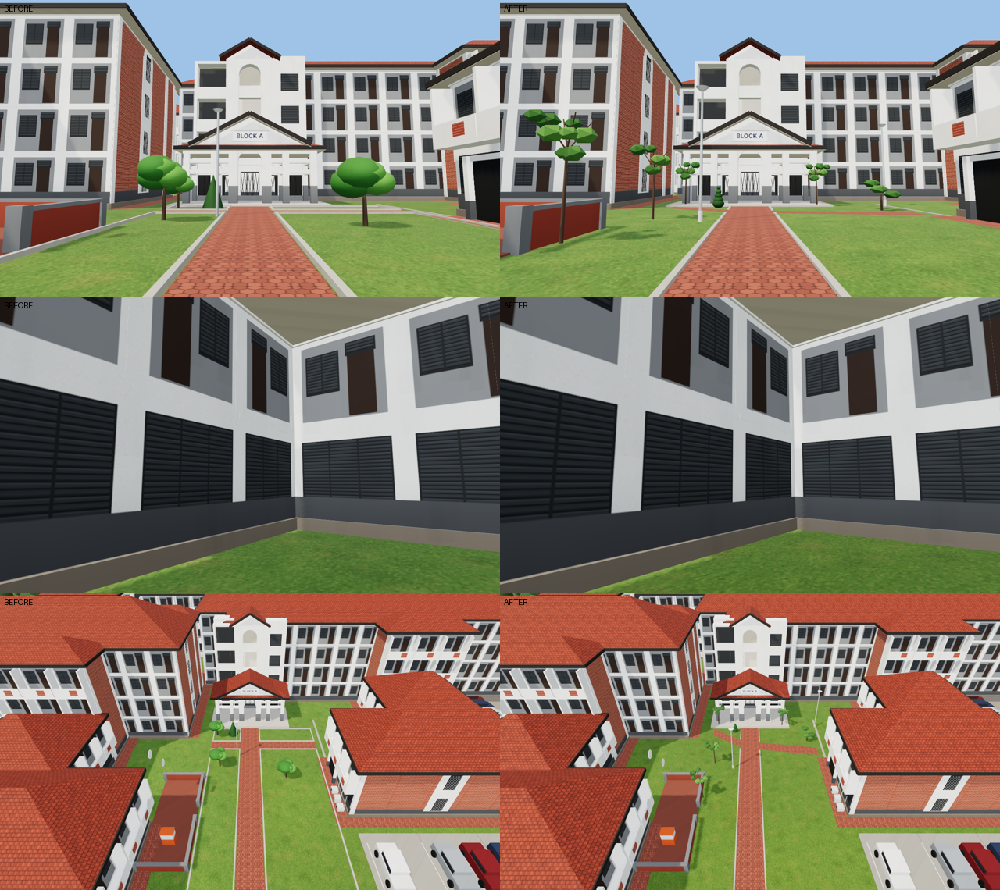
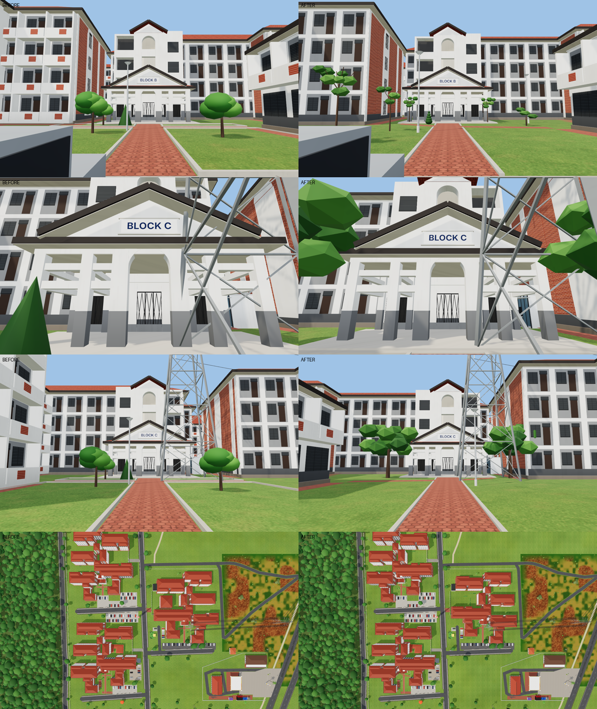

# New Pent Blocks A, B and C: detailed correction brief (2026-10-17)

The owner sent "LEGONRUSH_Pent_Block_Correction_Brief_DETAILED" (36 source slides, 61 pictures: aerial, real photos and
current-game screenshots) and a labelled aerial. The model is `src/game/newpent.ts` (block engine `blocks.ts`). The
placement comes from the project's map. The coloured outlines on the aerial were used only as a guide.

## Evidence checked

- **Aerial (slide 1):** Block B is the upper-left group, Block A the lower-left, and Block C lies east of Pent Road.
  A and B share one layout, with the car park and entrance on the Pent Road (east) side. Block C mirrors them: its
  car park and drive are on its west side, toward Pent Road. The game already places all three this way. The wings
  are the mapped outlines and were not moved.
- **Photos (slides 2-36):**
  - Four-storey wings under steep hipped terracotta roofs.
  - Cream render, a dark grey plinth and balcony bays with small brick panels.
  - Brick end walls, framed by pale vertical strips, with the tall arched stair window.
  - The front structures' brick fronts reach from the plinth to the eaves (slides 16, 35).
  - Red-brown interlocking pavers run along the blocks (slides 8-16).
  - The car parks are hardstand reaching the roads (slides 19-22, 30, 34, 36).
  - Paved drives lead to the grey steel gates in the brick walls along Pent Road (slides 21, 24).

## Changes

| Brief item | Before | After |
|---|---|---|
| Roof gables, ridges, eaves | shallow hips (pitch 0.42) | steeper hipped roofs (0.6), the ridges visible |
| Brick on the right elevations | brick faces with no frame | white render strips at both corners of every brick face, from base to eaves |
| Front structures' brick front | large louvre windows on the front's ground floor | brick from the grey plinth up, as slides 16 and 35 (`faceFirst` in `blocks.ts`); the large louvres stay on the sides |
| Pavers / lawn boundaries | lawn up to the walls | a 1.5 m apron of red-brown hexagonal pavers along the foot of every open wall |
| Parking on hardstand | lawn between the car parks and the roads | Block A's front and back car parks reach the road; the hardstand between Blocks A and B reaches the road, with a row of cars along its kerb |
| Gate and wall approach | lawn up to the gates | grey interlocking drives from Pent Road to the gates of Blocks A and B |
| Rails and posts | chain on posts round Block A's approach lawns | removed (not in slides 7 and 13); kerbs kept |
| Vegetation hiding facades | generic trees, hedge boxes and flower beds against the walls | none within 6 m of the walls (trees), 3 m (hedges) or 25 m (beds); the photographed trees (Block C's front, the car-park ends, Block A's approach) kept |

Unchanged:
- Positions, footprints and entrances.
- The kiosk, the generators and their shelters (slides 8, 23 and 31 show the white generator under its grey roof).
- The mast, the walls, the terrace with its low brick walls and grey caps, and the counter (slides 9, 10 and 13).
- Collisions and routes. The route and room tests pass.

## Comparable views (before | after)

Each pair is from the same camera.

## Open (needs another reference)

- The exact outline of each paved court inside the blocks. The aerial shows patterned gardens, a food court under a
  blue canopy in Block A and a white paved court in Block C. They are not modelled yet, because their extents cannot
  be measured from the stylised aerial.
- AC units and satellite dishes beyond the terrace already modelled. The photos show them, but not where on each wing.

## Entrances redesigned (owner's three entrance photos, 2026-10-17)

Blocks A and B share one design. Block C is its mirror image (`entrance(..., -1)`).

- **Porch:** two storeys high and about 11 m wide.
  - **Arch:** a tall round arch between two thick white piers.
  - **Columns and beams:** two slender square columns on each side, on dark grey feet, with two white beams across the front and down the sides and a white band above them.
  - **Roof:** a low tiled roof over the whole width, hipped at the ends. The middle rises as a gable whose white pediment carries BLOCK A / B / C over the arch.
  - **Lobby:** a dark lobby behind black steel grille gates, with a concrete landing at the foot of the paved approach.
- **Stair tower:** as wide as the porch.
  - **Centre:** a gabled middle with a tall round-headed recess in a moulded frame over the top two floors, a ledge across it, and open landings below it.
  - **Sides:** open landings behind solid white parapets on every floor on one side (left on A and B, right on C), and a rendered wall with dark glass-louvre windows on the other.

## Strict entrance correction, Blocks A and C (owner's annotated Block C comparison, the Block A photos and aerials, 2026-10-17)

Each item was checked against the real photographs, rendered from cameras close to them. Each row below is before | after from the same camera.

| # | Item | Change |
|---|---|---|
| 1 | Upper gable arch | A real recess, 0.7 m deep, cut into the tower's gabled middle. Its interior is pale, with the top corridor's slab and parapet crossing it and a moulded frame round it. The flat dark panel is gone. |
| 2 | Portico | Wider (columns at ±5.05 m) and deeper (6.8 m from the building to the front). A broad front gable spans the columns. Tiled hipped side roofs, dark fascias and pale soffits. The full-width bars are removed. |
| 3 | Ground-floor openings | A cream back wall with five separate bays. The doorway behind the arch and two bays either side each have their own black folding grille gate (frame, a few uprights, lattice diagonals). Shaded lobby beyond. |
| 4 | Columns and base | Square cream columns (0.52 m) with grey lower parts (1.5 m), paired at the back against the building. Thick piers either side of the arch. Two heavy beams across the front, the sides, and back to the building. |
| 5 | Roof geometry | The front gable spans 9.5 m with its pediment over the column line. The tower's taller gable stays behind it. The low hipped roof covers the whole porch. |
| 6 | Sign | A 2.9 m board, 0.8 m high, with "BLOCK A/B/C" across it, centred on the front gable over the arch. |
| 7 | Facade and orientation | Checked against the map and photos before any change. Block A: the brick to the left of the photo is the west wing's end (already brick), and the white balconied wall with AC units to the right is the front structure's west side (already white). Block C: the wall left of the entrance was brick in the game, but the photo shows white render with louvred windows. That wall (the west arm's east end) is now white with balconies (`WHITE_FACES`). The brick on the right of the Block C photo is the east wing's west end, which the game already has; it shows beyond the low front structure from the photo's closer viewpoint. No wing was moved or mirrored. |
| 8 | Ground | The wide rectangle of pavers and the lawn before the entrances are replaced on all three blocks by: a concrete landing with a step; a 2.6 m red-brown paver path to the car park or road; a 1.6 m branch path across it 4 m from the landing; four lawns behind low concrete kerbs; young trees; a clipped conical shrub by the landing; and a lamp post by the path. |
| - | Spacing | Each porch now sits in the middle of its court between the wings either side: A at x 562.5 (it had stood against the wing on its east), B at 558.2, C at 685.8 and set back 3.5 m against its wing face (z -701.5), as A's is. Only the porches moved, not the wings or their map positions. |

### Not verified / open

- The wing facades keep the one shared balcony-and-window design. The photos show some variation between wings (window groups, recessed openings), but not enough to model each wing.
- An electricity pylon from the map stands just in front of Block C's entrance court. It is not in the Block C photo and was left as mapped.

Entrance points for routing (`data/geography/registry/access.json`): A [562.5, -624.0], B [558.2, -762.0],
C [685.8, -697.5], inside each porch. The route test's mark for Block A moved with it (`scripts/route-tests.mjs`,
reason noted there); B and C stay within 5 m of the owner's marks.

Files changed: `src/game/newpent.ts`, `data/geography/registry/access.json` and the regenerated geography outputs,
`scripts/route-tests.mjs`, this document, `docs/handover/TASKS.md`.

## Blocks A and B identical, Block C their mirror image (owner, 2026-10-17)

The owner: Blocks A and B must be exactly the same, and Block C the same in mirror image. The map was checked first:

- **Block B:** fitted to Block A's nine outlines, Block B's are Block A's moved by (-4.2, -139.0) m. The mean edge error is 0.7 m.
- **Block C:** its outlines are Block A's mirrored about x = 624.15 and moved -74.8 m in z. The mean edge error is 3.5 m, and nearly all of it comes from one place, where the map merges a wing of C with its front structure into one outline. Every other wing is within 1-3 m.

The site layout therefore confirms both the copy and the mirror. `newpent.ts` now builds all three blocks from Block A's outlines: B is the copy and C is the mirror (`NP_B`, `NP_C`). Block B's and Block C's own map outlines are replaced, not drawn. The entrances follow the same transforms, the stair tower's open side mirrored on C. The routing entrance points follow too: B [558.3, -763.0], C [685.8, -698.8], both within 5 m of the owner's earlier marks. Roads, routes and the rest of the site are unchanged.

### Court and planting from the owner's annotated court photo (items 7-9)

- **Paths:** one straight paver path to the porch between concrete kerbs. On the left, a branch leaves it about 4 m before the landing, angles back toward the building and runs along it to the wing, with a small lawn between it and the landing. On the right, a branch runs out to the right wing, drifting slightly toward the road. Lawn everywhere else; the kerbed lawn rectangles of the last version are gone.
- **Blocks A and B:** young thin-stemmed trees with loose crowns, as in the photo: one beside each side of the porch, two further out on the left and a bushier one by the right wing. A small clipped conical shrub on the little lawn by the landing. Lamp posts left of the path and by the right wing. The generic round trees are gone.
- **Block C:** the mirrored court, with a mature tree on either side of the porch (the Block C photo).

Views: front, angled, elevated court, Block B front, Block C close and far, and the whole site from above. Each is before | after from the same camera, near-level so that verticals stay vertical; the leaning walls in earlier renders were camera tilt, not the geometry.

### Not verified

- The individual window and balcony arrangement of each wing (items 3 and 12-14: stepped wings and the small window column on the right wing). The shared wing design is kept; the photos do not show every wing.
- The vegetation on Block B, which has no photo, follows Block A's because the owner says the two are the same.
